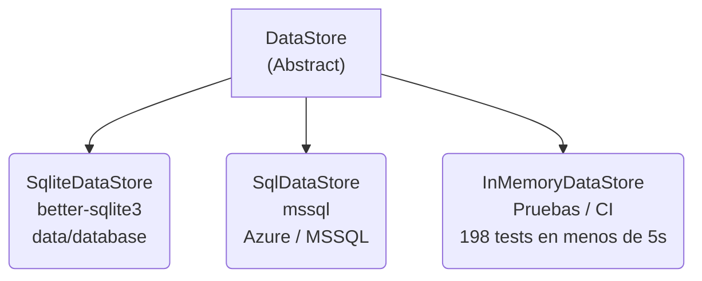
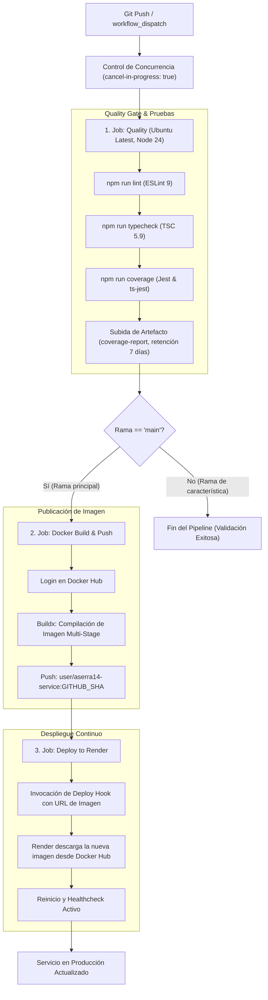

# TP DevOps - Universidad de Palermo
<p align="center">


</p>

Para el Trabajo Práctico de la matera DevOps, prepare una API moderna y modular migrada desde el backend legacy en **.NET / C#** del proyecto GamingTrends, a **NestJS** sobre el runtime de **Node.js 24**, diseñada bajo principios de arquitectura limpia, observabilidad continua e integración/despliegue continuo (CI/CD).

La solución incorpora una **estrategia dual de base de datos**:
- **SQLite Local Embebido**: Permite una ejecución inmediata, "zero-config" y autocontenida con datos pre-sembrados, ideal para desarrollo local, evaluación y pruebas.
- **Azure SQL Server / SQL Server**: Motor relacional utilizado para entornos de producción y nube.

El sistema se encuentra 100% contenedorizado con **Docker** y **Docker Compose**, monitoreado en tiempo real con **New Relic APM**, y gobernado por un pipeline automatizado de **GitHub Actions** que compila, prueba, construye y publica la imagen en **Docker Hub** y orquesta el despliegue automático en **Render**.

> [!NOTE]
> La documentación interactiva OpenAPI / Swagger se encuentra expuesta en el endpoint:
> `/docs` (de la URL correspondiente al despliegue).

---

## 1. Decisiones Arquitectónicas

### 1.1. Migración de .NET C# a NestJS / Node.js 24
La decisión de migrar el backend legacy desde .NET C# hacia **NestJS** y **Node.js 24** se basó en la facilidad de uso de Node y NestJS en los entornos operativos actuales. Ademas el uso de estas nuevas tecnologías facilitaron el cumplimiento de los siguientes pilares de ingeniería:
- **Modularidad Orientada al Dominio (*Domain-Driven Modules*)**: NestJS ofrece una separación estricta de responsabilidades mediante módulos (`auth`, `users`, `games`, `developers`, `genres`, etc.), facilitando el mantenimiento, la escalabilidad y las pruebas unitarias aisladas.
- **Inyección de Dependencias Robusta (IoC / DI)**: Permite desacoplar los servicios de negocio de la infraestructura de persistencia, facilitando el intercambio de motores de base de datos sin alterar los casos de uso.
- **Tipado Estricto con TypeScript**: Mantiene la seguridad de tipos estática que caracterizaba a C#, minimizando errores en tiempo de ejecución.
- **Compatibilidad con Ecosistemas Cloud-Native Modernos**: El runtime Node.js 24 proporciona un inicio rápido (*fast startup*), bajo consumo de memoria y compatibilidad nativa con contenedores Linux ligeros (`node:24-alpine`).

### 1.2. Compatibilidad de Protocolo con el Backend Legacy
Para asegurar una transición transparente para el front sin exigir cambios en el cliente, se implementaron los siguientes mecanismos de compatibilidad:
- **`KeyNormalizePipe` (Normalización Bidireccional de Nomenclatura)**:
  Transforma recursivamente los nombres de propiedades entre `PascalCase` (convención utilizada en .NET / C#) y `camelCase` (convención idiomática de TypeScript / NestJS). Permite que la API reciba peticiones formuladas según los contratos antiguos y procese internamente objetos normalizados.
- **Código HTTP de Respuesta `@HttpCode(200)` en Endpoints `POST`**:
  Mientras NestJS responde por defecto con `201 Created` ante solicitudes `POST`, los clientes HTTP heredados de .NET y librerías cliente esperan un estricto `200 OK`. Se configuró la anotación `@HttpCode(200)` en todos los controladores de creación y mutación para evitar rupturas de contrato.
- **Algoritmo de Hashing de Contraseñas PBKDF2/SHA**:
  Se implementó una rutina criptográfica idéntica a la utilizada por ASP.NET Core Identity (`PBKDF2` con HMAC-SHA256, salt criptográfico de 128 bits e iteraciones calibradas). Esto garantiza que las contraseñas migradas desde la base de datos original sigan siendo plenamente válidas y verificables sin forzar un reseteo masivo de usuarios.
- **Validación Tolerante con `class-validator`**:
  La validación global se configuró con `whitelist: true` y `forbidNonWhitelisted: false`. Esto permite absorber de forma segura cargas útiles con metadatos o campos extras provenientes de versiones anteriores de los clientes sin rechazar la solicitud con errores HTTP 400.

### 1.3. Patrón `DataStore` y Estrategia Multi-Motor
Se desacopló la lógica de acceso a datos mediante el contrato abstracto `DataStore`, permitiendo intercambiar de manera transparente la infraestructura de persistencia:



1. **`SqliteDataStore` (Persistencia Local Embebida)**:
   - Basado en el driver síncrono `better-sqlite3`.
   - Lee y persiste el archivo local pre-sembrado en `data/database.sqlite3`.
   - Ofrece una experiencia de desarrollo y evaluación inmediata sin necesidad de levantar contenedores adicionales ni configurar bases de datos externas.
2. **`SqlDataStore` (Producción en Nube / Azure SQL)**:
   - Basado en el driver oficial `mssql` con soporte para connection pooling optimizado y reconexión resiliente.
   - Aplica consultas totalmente parametrizadas mediante `request.input()`, garantizando protección total frente a inyecciones SQL.
   - Soporta TLS y cifrado de conexión (`encrypt: true`) para cumplir los estándares de seguridad de Azure Database.
3. **`InMemoryDataStore` (Pruebas Unitarias Aisladas)**:
   - Emula un almacén relacional estructurado en memoria.
   - Permite que los 198 tests unitarios y de integración se ejecuten en pocos segundos en entornos locales y en el flujo de CI, eliminando la latencia de red y dependencias de bases de datos externas.
4. **Selección Dinámica vía Variable de Entorno**:
   - La selección del proveedor se resuelve dinámicamente en `StoreModule` evaluando la variable `DB_TYPE` (`sqlite` o `azure`).

### 1.4. Safeguard y Validación Temprana (`onModuleInit`)
En `StoreModule`, la aplicación implementa el hook del ciclo de vida `OnModuleInit`:
- Al arrancar la aplicación, se ejecuta proactivamente una consulta centinela (`SELECT 1 AS [ok]`).
- Si la conexión falla, se emite inmediatamente un mensaje estructurado y visible en los registros (`Logger.error`), alertando al operador antes de comenzar a servir tráfico HTTP.
- Si la conexión es exitosa, se reporta el estado exacto del motor (`✅ Base de datos SQLite lista en...` o `✅ Base de datos SQL Server conectada en...`).

### 1.5. Documentación Swagger Automatizada
- Integración del plugin `@nestjs/swagger` dentro de `nest-cli.json` con `introspectComments: true` y `classValidatorShim: true`.
- Extrae automáticamente metadatos, tipos y descripciones desde las clases DTO y comentarios de código sin requerir decoradores redundantes en cada propiedad.
- Expone la interfaz gráfica Swagger UI en la ruta `/docs`.

### 1.6. Observabilidad Integrada con New Relic
- El agente de **New Relic APM** se inyecta en tiempo de ejecución (`node -r newrelic dist/main.js`).
- Proporciona instrumentación automática de transacciones HTTP, medición de tiempos de respuesta, tasa de rendimiento (*throughput*), trazabilidad de errores no controlados y análisis de consumo de memoria y CPU.

---

## 2. Pipeline de CI/CD y Diagrama de Flujo

El flujo de entrega continua está automatizado mediante GitHub Actions en `.github/workflows/ci.yml`.

### Diagrama del Flujo de Trabajo



### Explicación de Etapas y Compuertas de Calidad

1. **Control de Concurrencia**:
   Se define `concurrency: { group: ci-${{ github.ref }}, cancel-in-progress: true }`. Si se realiza un nuevo *push* sobre la misma rama mientras una ejecución previa se encuentra en curso, la anterior es cancelada automáticamente para ahorrar minutos de cómputo y evitar condiciones de carrera.
2. **Etapa 1: Quality (Compuerta Obligatoria)**:
   - Se ejecuta en todas las ramas ante cualquier evento `push` o ejecución manual (`workflow_dispatch`).
   - Configura el entorno oficial Node.js 24 con caché de dependencias de `npm`.
   - Realiza instalación reproducible con `npm ci`.
   - Ejecuta análisis estático con `npm run lint`.
   - Valida la coherencia estricta de tipos con `npm run typecheck`.
   - Corre la totalidad de los 198 tests unitarios y de integración con cálculo de métricas en `npm run coverage`.
   - Almacena el directorio `coverage/` como artefacto descargable durante 7 días (`actions/upload-artifact@v7`).
3. **Etapa 2: Docker Build & Push**:
   - Condicionado a ejecutarse **únicamente en la rama `main`** y supeditado al éxito absoluto de la etapa previa (`needs: quality`).
   - Autentica contra Docker Hub con secretos seguros (`DOCKER_USER`, `DOCKER_PASS`).
   - Construye la imagen multi-etapa utilizando Docker Buildx.
   - Publica la imagen inmutable etiquetada con el hash del commit: `${DOCKER_USER}/aserra14-service:${GITHUB_SHA}`.
4. **Etapa 3: Deploy to Render**:
   - Condicionado a ejecutarse tras la publicación exitosa del contenedor (`needs: docker`).
   - Realiza una petición segura vía `curl` al *Deploy Hook* de Render, inyectando como parámetro la URI exacta de la imagen publicada en Docker Hub (`imgURL=docker.io/...`).
   - Render descarga el contenedor, verifica las sondas de salud y promueve la nueva versión con cero tiempo de inactividad (*zero-downtime deployment*).

---

## 3. Herramientas Utilizadas y Evidencia

### Stack Tecnológico

| Categoría | Tecnología / Herramienta | Propósito en el Proyecto |
| :--- | :--- | :--- |
| **Runtime & Lenguaje** | Node.js |  Runtime de ejecución rápido y compatible con estándares modernos. |
| **Lenguaje** | TypeScript |  Tipado estático robusto y detección de errores en tiempo de compilación. |
| **Framework Backend** | NestJS |  Arquitectura modular escalable con inyección de dependencias. |
| **Bases de Datos** | SQLite (`better-sqlite3`) |  Motor relacional embebido para ejecución local "zero-config". |
| **Bases de Datos** | Azure SQL / SQL Server (`mssql`) |  Motor relacional escalable de producción en la nube. |
| **Contenedores** | Docker & Docker Compose |  Empaquetado aislado y reproducible para desarrollo y producción. |
| **CI / CD** | GitHub Actions |  Automatización de compilación, calidad, empaquetado y entrega. |
| **Registry de Imágenes** | Docker Hub |  Almacenamiento seguro y versionado de imágenes de contenedor. |
| **Plataforma Cloud** | Render |  Hospedaje y ejecución del contenedor en infraestructura en la nube. |
| **Observabilidad** | New Relic APM |  Monitoreo en tiempo real de transacciones, latencia y métricas de runtime. |
| **Documentación** | Swagger / OpenAPI |  Documentación viva de contratos y consola interactiva de pruebas. |
| **Testing & Calidad** | Jest, ts-jest, Supertest | Pruebas unitarias, pruebas de integración y cálculo de cobertura (>90%). |
| **Linter & Formato** | ESLint | Reglas estrictas de calidad de código y mejores prácticas TypeScript. |
| **Seguridad HTTP** | Helmet | Configuración segura de cabeceras HTTP contra vulnerabilidades web. |

### Evidencia de Funcionamiento (Capturas de Pantalla)

A continuación se presentan los espacios designados para las evidencias gráficas del correcto funcionamiento de cada componente de la plataforma:

#### 1. Pipeline de CI/CD en GitHub Actions
> Evidencia de la ejecución exitosa de los 3 jobs en GitHub Actions (`Quality`, `Docker Build & Push`, `Deploy to Render`).


#### 2. Imagen Publicada en Docker Hub
> Evidencia de la imagen publicada en Docker Hub


#### 3. Servicio Activo en Render
> Evidencia del servicio activo en Render


#### 4. Dashboard de Observabilidad en New Relic APM
> Evidencia del dashboard de New Relic reflejando el rendimiento del servicio, métricas de transacciones y apdex score.


---

## 4. Análisis bajo Principios DevOps y Lean

En este proyecto aplicamos prácticas DevOps y principios Lean con un objetivo claro: que el software se pueda desarrollar, probar y poner en producción de forma automática, confiable y sin depender de tareas manuales repetitivas.

---

### 4.1. Prácticas DevOps aplicadas al proyecto

#### 1. Infraestructura como Código (IaC) y Paridad de Entornos
* **Mismo entorno en todos lados:** Mediante el `Dockerfile` y `docker-compose.yml`, la infraestructura queda definida en código y versionada en el repositorio.
* **Fin del *"en mi máquina funciona"*:** El código se ejecuta exactamente bajo las mismas condiciones en la máquina del desarrollador, en los servidores de GitHub Actions y en la nube (Render). Esto acelera la puesta en producción y evita sorpresas por diferencias de configuración.

#### 2. Pipeline de CI/CD, Quality Gates y el concepto de "Andon Cord"
* **Automatización de punta a punta:** Cada cambio subido a la rama principal pasa por un pipeline automático en GitHub Actions: verifica código -> corre pruebas -> arma la imagen Docker -> la publica en Docker Hub -> notifica a Render para el despliegue.
* **Quality Gates (Compuertas de Calidad):** Antes de generar una imagen o desplegar, el código debe aprobar tres filtros obligatorios: linteo (ESLint), chequeo de tipos estricto (`tsc`) y más del 90% de cobertura en tests.
* **Andon Cord (Parada de línea):** Tomando el principio de manufactura Lean, si un test o validación falla en el pipeline, la ejecución se detiene de inmediato. Ningún código con errores llega a producción ni consume recursos innecesarios.

#### 3. Resiliencia y Observabilidad Proactiva
* **Endpoints de salud (`/health` y `/health/ready`):** Permiten saber si el servicio está vivo y si la base de datos responde. Si algo falla, el orquestador puede reiniciar el contenedor o dejar de enviarle tráfico antes de que afecte a los usuarios.
* **Telemetría con New Relic APM:** Monitorea tiempos de respuesta, errores y consumo en tiempo real. En lugar de esperar a que un usuario avise que el sistema falló, el equipo puede ver las fallas y cuellos de botella al instante desde el dashboard.

#### 4. Responsabilidad Compartida y Git como Fuente Única de Verdad
* **Colaboración sin silos:** El equipo de desarrollo no se desentiende de cómo corre la app en producción. En el mismo repositorio se definen la seguridad HTTP, variables de entorno, Dockerfile y los flujos de CI/CD.
* **Control total de versiones:** Todo cambio de código, infraestructura o despliegue queda registrado en Git, facilitando auditorías, trabajo en equipo y la posibilidad de volver atrás (*rollback*) rápidamente si surge un problema.

---

### 4.2. Principios Lean: Reducción del Desperdicio de Tiempo y Esfuerzo

El pensamiento Lean se enfoca en entregar valor continuo al usuario eliminando cualquier forma de desperdicio (muda). En el desarrollo tradicional, la mayor pérdida de tiempo proviene de tareas manuales repetitivas (configurar servidores a mano, generar imágenes y desplegar por SSH o similares), tiempos muertos de espera y la corrección tardía de errores en producción que obligan a rehacer trabajo.

En este proyecto atacamos ese desperdicio mediante la automatización integral de la entrega y la calidad en origen. El pipeline de CI/CD junto con la infraestructura en código (IaC) convierte la gestión manual en un proceso que compila, prueba y despliega en Render en pocos minutos sin intervención humana. Al mismo tiempo, las compuertas de calidad automáticas detienen los defectos en el momento del commit, y la configuración "Zero-Config" con Docker Compose permite a cualquier desarrollador o evaluador levantar el sistema al instante, eliminando tiempos de espera y permitiendo al equipo enfocarse únicamente en construir valor.

---

### 4.3. Las Tres Vías de DevOps

1. **Flujo rápido (Primera Vía):** Pasamos del código a producción de manera continua y sin fricciones mediante automatización completa.
2. **Feedback continuo (Segunda Vía):** Recibimos avisos inmediatos si algo se rompe, tanto en desarrollo (tests en segundos) como en producción (New Relic y health checks).
3. **Aprendizaje y mejora (Tercera Vía):** Al contar con un entorno seguro y reproducible, es fácil experimentar, refactorizar y mejorar el sistema sin miedo a romperlo.

---

## 5. Guía de Ejecución Local (Zero-Config)

El proyecto está configurado para ejecutarse inmediatamente de forma local sin requerir la instalación previa de servidores de bases de datos.

### Opción A: Ejecución con Docker Compose (Recomendada)

1. Clonar el repositorio y posicionarse en la carpeta raíz:
   ```bash
   cd DevOps_TP
   ```

2. Iniciar el servicio con Docker Compose:
   ```bash
   docker-compose up
   ```

3. El contenedor levantará en modo desarrollo, cargará la base de datos SQLite pre-sembrada (`data/database.sqlite3`) y expondrá el servidor en el puerto `3000`:
   - API: `http://localhost:3000`
   - Swagger UI: `http://localhost:3000/docs`
   - Sonda de Salud: `http://localhost:3000/health`

### Opción B: Ejecución Nativa con Node.js

1. Asegurarse de utilizar **Node.js 24**:
   ```bash
   node -v # >= 24.0.0
   ```

2. Instalar las dependencias del proyecto:
   ```bash
   npm ci
   ```

3. Copiar y configurar las variables de entorno:
   ```bash
   cp .env.example .env
   ```

4. Iniciar en modo desarrollo con recarga en caliente (*watch mode*):
   ```bash
   npm run start:dev
   ```

---

## 6. Endpoints de Salud y Diagnóstico (Health Checks)

La API implementa dos sondas de diagnóstico con `@nestjs/terminus` para su integración con orquestadores de contenedores y plataformas de monitoreo:

### 1. Liveness Probe (`GET /health`)
- **Propósito**: Confirma que el hilo de ejecución principal y el servidor HTTP de Node.js responden adecuadamente.
- **Uso**: Invocado por la instrucción `HEALTHCHECK` del `Dockerfile` cada 30 segundos.
- **Respuesta (200 OK)**:
  ```json
  {
    "status": "ok",
    "info": {},
    "error": {},
    "details": {}
  }
  ```

### 2. Readiness Probe (`GET /health/ready`)
- **Propósito**: Verifica que la aplicación no solo esté viva sino en condiciones de atender tráfico de negocio, evaluando activamente la conectividad con la base de datos subyacente mediante `DataStore.ping()`.
- **Respuesta Saludable (200 OK)**:
  ```json
  {
    "status": "ok",
    "info": {
      "database": {
        "status": "up"
      }
    },
    "error": {},
    "details": {
      "database": {
        "status": "up"
      }
    }
  }
  ```
- **Respuesta con Degradación (503 Service Unavailable)**:
  Retorna código `503` en caso de que la base de datos se encuentre inaccesible, previniendo que los balanceadores de carga enruten tráfico a una instancia no funcional.

---

## 7. Comandos de Pruebas y Aseguramiento de Calidad

El proyecto dispone de scripts estandarizados en `package.json` para validar la estabilidad del sistema:

```bash
# Ejecutar la suite completa de pruebas unitarias y de integración (198 tests)
npm test

# Ejecutar pruebas con cálculo y reporte completo de cobertura de código
npm run coverage

# Ejecutar pruebas end-to-end (E2E)
npm run test:e2e

# Análisis estático de código con ESLint
npm run lint

# Verificación de compilación y tipos con TypeScript
npm run typecheck

# Auditoría de seguridad de dependencias en producción
npm run audit

# Ejecución consolidada del pipeline de calidad local
npm run ci
```
